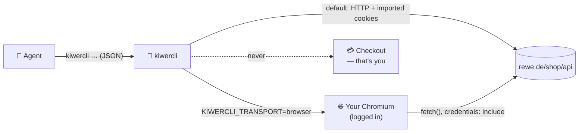

<p align="center">
  
</p>

<p align="center">
  <a href="LICENSE"></a>
  
  
  
</p>

<p align="center">
  <a href="#-quick-start">Quick start</a> ·
  <a href="#-sessions">Sessions</a> ·
  <a href="#-commands">Commands</a> ·
  <a href="#-agent-skill">Agent skill</a> ·
  <a href="#-how-it-works">How it works</a>
</p>

---

**kiwercli** lets an AI agent do the tedious part of grocery shopping: find the products, pick
sensible ones and put them into your REWE basket — for **Lieferservice** or **Abholservice**.
Every command prints JSON, so agents can read it without guessing.

The last step stays yours: kiwercli **never places an order**. You open rewe.de, look at the
basket and check out.

<p align="center">
  
</p>

> **Disclaimer:** Unofficial project, not affiliated with, endorsed by or connected to REWE Group
> or REWE digital. It uses undocumented web APIs that can change or break at any time.

## ✨ Features

<table>
  <tr>
    <td width="33%" valign="top"><b>🚚 Delivery &amp; pickup</b><br>One command resolves the delivery market for your ZIP code; pickup markets work too.</td>
    <td width="33%" valign="top"><b>🔍 Precise search</b><br>Category slugs, sorting, offers, organic, regional, vegan — so “Milch” finds milk, not shower gel.</td>
    <td width="33%" valign="top"><b>🛒 Basket only</b><br>Add, bulk-add, update, remove. No command submits an order, and a test checks every command name.</td>
  </tr>
  <tr>
    <td valign="top"><b>🌐 Browser transport</b><br>Requests run inside your own logged-in Chromium. No passwords, no stored cookies.</td>
    <td valign="top"><b>🧾 Order history</b><br><code>orders items</code> lists what you bought last time — perfect for “same as last week”.</td>
    <td valign="top"><b>🤖 Agent skill</b><br>A ready-made <code>SKILL.md</code> teaches Claude Code &amp; co. the commands and the one hard rule.</td>
  </tr>
</table>

## 🚀 Quick start

```bash
git clone https://github.com/harryherbig/kiwercli.git
cd kiwercli
npm install && npm run build
npm link                                   # optional: puts `kiwercli` on your PATH
```

```bash
kiwercli store set-delivery 50667          # Lieferservice — market resolved from the ZIP
kiwercli store set 840254 66113            # …or Abholservice — pickup market ID + ZIP

kiwercli search "Vollmilch" --category milch --sort PRICE_ASC
kiwercli basket add <listingId> --qty 2
kiwercli basket show
```

Requires **Node.js 22+**. Search and store selection work without a login; basket, favorites,
orders and timeslots need a session.

## 🔐 Sessions

### Browser transport — recommended

kiwercli opens a `https://www.rewe.de/shop/` tab in a Chromium you are logged into and runs each
request there as `fetch()`. It never sees your password and stores no cookies.

```bash
# once: start Chromium with remote debugging and log in to rewe.de in it
chromium --remote-debugging-port=9223 --user-data-dir="$HOME/.config/kiwercli/chromium"

export KIWERCLI_TRANSPORT=browser
kiwercli basket show
```

Getting `401`/`403`? Log in to rewe.de again in that browser.

### Cookie import

```bash
kiwercli import-cookies cookies.txt    # Netscape format
kiwercli import-cookies cookies.json   # CDP getAllCookies or Playwright storageState
```

Cookies are saved to `~/.config/kiwercli/session.json` (mode 600) and expire quickly. From some
networks REWE answers the built-in HTTP client with `403`; the browser transport sends requests
from your real browser instead.

## 📖 Commands

| Command | What it does |
|---|---|
| `store show` | Current market, ZIP and service type |
| `store set <wwIdent> <zip>` | Use a pickup market |
| `store set-delivery <zip>` | Use delivery for a ZIP code |
| `search <query> [options]` | Search products — no login needed |
| `basket show` | Current basket |
| `basket add <listingId> [--qty N]` | Add an item |
| `basket bulk-add '<json>'` | Add several: `[{"listingId":"…","qty":1}]` |
| `basket update <listingId> <qty>` | Change a quantity |
| `basket remove <listingId>` · `basket clear` | Remove one · all items |
| `favorites [show\|search\|add\|delete]` | Your favorites list |
| `timeslots` · `timeslot-reserve <slotId>` | Pickup or delivery slots, per store setup |
| `orders show` · `orders get <orderId>` | Order history · details |
| `orders items <orderId>` | Items of an order: `name`, `productId`, `quantity`, `price` |
| `orders cancel <orderId>` | Cancel an order |
| `receipts show` · `receipts download <id>` | Digital receipts as JSON · PDF |
| `suggestion <N>` | Often-ordered items that are not in the basket yet |

Add `-p` for pretty-printed JSON. Prices are in **cents** (`199` = 1,99 €).

<details>
<summary><b>Search options &amp; category slugs</b></summary>

| Option | Description |
|---|---|
| `--category <slug>` | Restrict to a category — strongly recommended |
| `--sort <order>` | `RELEVANCE_DESC`, `PRICE_ASC`, `PRICE_DESC`, `NAME_ASC`, `NAME_DESC` |
| `--page <n>`, `--per-page <n>` | Pagination (default 1, 40) |
| `--offers` `--organic` `--regional` `--vegan` `--vegetarian` | Filters |

| Category | Slug | Category | Slug |
|---|---|---|---|
| 🥛 Milk | `milch` | 🍝 Pasta | `nudeln` |
| 🥚 Eggs | `eier-ei-ersatz` | 🍚 Rice | `reis` |
| 🧀 Hard cheese | `hartkaese` | 🍎 Fresh fruit | `frisches-obst` |
| 🧀 Fresh cheese | `frischkaese` | 🥕 Fresh vegetables | `frisches-gemuese` |
| 🍗 Poultry | `gefluegelfleisch` | 🧂 Spices | `gewuerze` |
| 🥩 Pork · Beef | `schweinefleisch` · `rindfleisch` | 🧈 Butter | `butter` |
| 🥓 Bacon · ham | `roher-schinken-speck` | 🍞 Bread | `brot` |

Slugs are kebab-case German category names (ä→ae, ö→oe, ü→ue). `categoryPath` in any search
result shows the exact one.

</details>

## 🤖 Agent skill

[`skills/kiwercli/SKILL.md`](skills/kiwercli/SKILL.md) is an [Agent Skill](https://agentskills.io).
Copy the folder into your agent's skills directory, e.g. `~/.claude/skills/kiwercli/`, and ask:

> *„Pack mir alles für Spaghetti Carbonara für vier Personen in den Warenkorb.“*

The agent searches with the right categories, fills the basket, shows you the total — and stops.

## ⚙️ How it works



| Setting | Default | Purpose |
|---|---|---|
| `KIWERCLI_TRANSPORT` | `axios` | `browser` sends requests through your Chromium |
| `KIWERCLI_CDP_URL` | `http://127.0.0.1:9223` | DevTools endpoint for the browser transport |

State lives in `~/.config/kiwercli/` (or `$XDG_CONFIG_HOME/kiwercli/`).

## 🧪 Development

```bash
npm test                    # offline: fake CDP, real order-page markup
KIWERCLI_LIVE=1 npm test    # plus REWE's public product search
```

**Known limitations:** `store search <zip>` does not return real pickup markets (look the ID up
on rewe.de) · reserving a delivery timeslot is untested · `orders items` falls back to parsing the
order page HTML, which can change without notice.

## 🙏 Credits

kiwercli is built on [**karrt**](https://github.com/Tobi4s1337/karrt) by Tobias Klaus, who did the
groundwork: the REWE web API client, basket, orders and receipts. kiwercli adds
delivery support, the browser transport, JSON cookie import, `orders items` and the agent skill.

## 📄 License

MIT — see [LICENSE](LICENSE).
